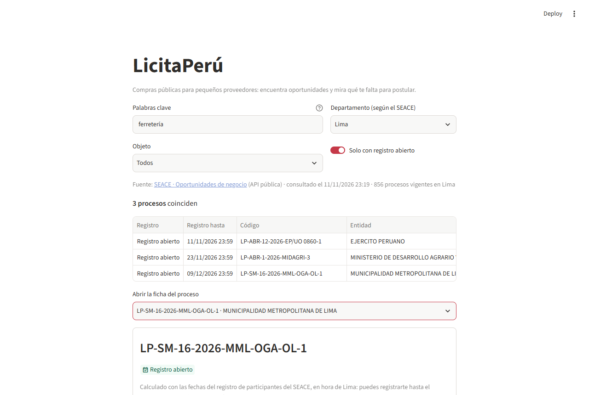
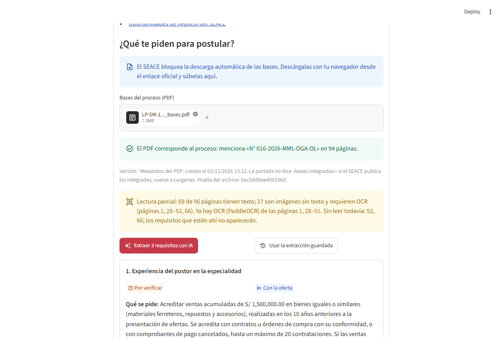
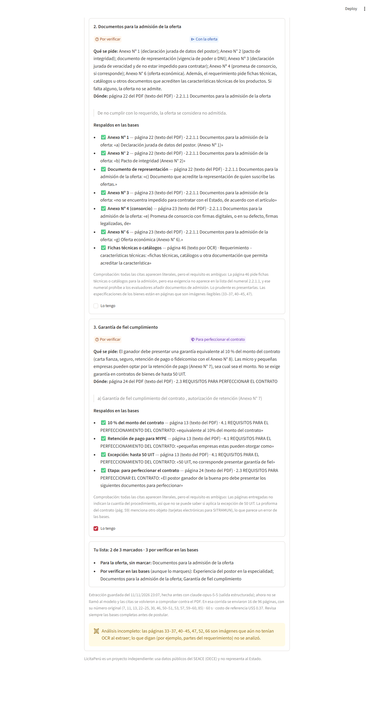

# LicitaPerú

**Ayudamos a pequeños proveedores del Estado a encontrar compras públicas abiertas y a saber qué les falta para postular, con un radar sobre los datos del SEACE y un evaluador con IA que cita cada requisito de las bases.**

Proyecto final de la Diplomatura de Especialización en Ciencia de Datos para las Ciencias Sociales y la Gestión Pública (Q-Lab PUCP), [issue #204](https://github.com/d2cml-ai/Data-Science-Python/issues/204).

> **Estado (11/11/2026):** la demo completa (radar + evaluador) **corre en local**. La URL pública está pendiente: el evaluador usa por ahora la CLI de Claude Code de la computadora donde corre, y publicarlo requiere una clave de API con tope de gasto.

---

## 1. One-liner

Hacemos **que un pequeño proveedor sepa en minutos si puede postular a una compra del Estado y qué documentos preparar**, para **ferreterías y distribuidores que venden al Estado peruano**, mediante **un radar de procesos abiertos del SEACE y un evaluador que lee las bases (con OCR si están escaneadas) y devuelve requisitos con página, sección y cita verificada**.

## 2. Founder

**Mirian de la Cruz Condori**, participante de la Diplomatura de Ciencia de Datos para las Ciencias Sociales y la Gestión Pública (Q-Lab PUCP).

> **PENDIENTE (Mirian):** por qué eres la persona indicada para este problema (experiencia con compras públicas, proveedores o MYPE, contexto regional, etc.). No se completa con suposiciones.

## 3. Problema

**Quién lo sufre.** Pequeños proveedores (ferreterías, distribuidores de materiales y herramientas) que quieren vender al Estado. Solo en 2026, los datos abiertos del OECE registran **321 convocatorias adjudicadas** de bienes de ferretería, materiales eléctricos o herramientas, por **S/ 71.5 millones**, ganadas por **274 proveedores distintos** (63 personas naturales). *Estimación por palabras clave sobre el conjunto «Adjudicaciones 2026» del portal CONOSCE, consultado el 11/11/2026; detalle en [docs/verificacion_fuentes.md](docs/verificacion_fuentes.md).*

**Cuánto le cuesta.** El caso real de esta demo (Municipalidad Metropolitana de Lima, *LP-SM-16-2026-MML-OGA-OL-1*) lo muestra:

- Las bases tienen **96 páginas**; **27 son imágenes sin texto**, entre ellas el requerimiento (páginas 28–52).
- El requisito que decide si puedes postular —**haber facturado S/ 1,500,000.00 en 10 años** en bienes similares— está en una **página escaneada** (p. 50).
- Las bases se contradicen: la p. 46 pide **fichas técnicas o catálogos para la admisión**, pero la lista de documentos de admisión (pp. 22–23) no las incluye y prohíbe agregar documentos.
- Si falta un documento de admisión, «**la oferta se considera no admitida**» (p. 22).

**Cómo lo resuelve hoy.** El SEACE ofrece un buscador y la app «Oportunidades de negocio» (alertas por correo), pero no dice qué pide cada proceso: el proveedor lee el PDF completo o paga a un asesor. *Hipótesis por validar en las entrevistas.*

**Conversaciones con usuarios potenciales:** [docs/research/](docs/research/). **PENDIENTE:** las 3 conversaciones todavía no se han realizado o no se han entregado; las plantillas están listas y no se completan con datos inventados.

## 4. Solución e insight

**Solución.** Dos piezas en una sola app:

1. **Radar** de procesos vigentes del SEACE: búsqueda por palabras (sin importar tildes), filtro por departamento (lo hace el propio SEACE con el código INEI), estado del **registro de participantes** en hora de Lima y **plazo de propuestas** por separado, con enlaces oficiales.
2. **Evaluador de requisitos**: el proveedor sube las bases en PDF; la app comprueba que sean del proceso, detecta páginas escaneadas y usa OCR, envía al modelo **solo las páginas relevantes** y recibe 3 requisitos con **respaldos**: cada cifra, condición, documento y etapa con su página, sección y cita. **Cada cita se busca literal en el PDF**; si algo no se puede comprobar o las bases son ambiguas, el requisito queda **«Por verificar»**. El proveedor marca «Lo tengo» y ve qué le falta, sin que marcar cambie lo verificado.

**Insight.**

- Lo que decide si puedes postular suele estar **en el requerimiento, que muchas entidades insertan escaneado**: sin OCR, una IA «lee» las bases y se pierde el requisito clave.
- Las bases **se contradicen**; una herramienta útil no da una respuesta segura, sino **la cita y la duda**.
- Las bases son **las mismas para todos los postores** de un proceso: el OCR y la extracción se pueden hacer una vez y reutilizar (aquí: «Usar la extracción guardada»), lo que baja el costo por usuario.

## 5. Why now

- **Nueva normativa:** las bases del caso ya se rigen por la **Ley N° 32069** y su Reglamento (D.S. N° 009-2025-EF) y remiten a la **Pladicop**; los proveedores tienen que volver a aprender formatos y requisitos.
- **Datos abiertos utilizables:** el SEACE publica en JSON los procesos vigentes (la API que usa su app «Oportunidades de negocio»), y el OECE publica los históricos.
- **IA verificable:** los modelos actuales devuelven salidas que cumplen un **JSON Schema** y citan textualmente, lo que permite comprobar cada cita con código; y un **OCR abierto** (PaddleOCR) lee estas páginas en una laptop (confianza media 0.977; 0.99 sin contar la tabla girada de la p. 52 y el logotipo de la p. 66).

## 6. Demo

### Cómo correrla en Windows (PowerShell)

Requisitos: [uv](https://docs.astral.sh/uv/) (probado con 0.13.6), Git, y para el evaluador la CLI de [Claude Code](https://claude.com/claude-code) con sesión iniciada.

```powershell
git clone https://github.com/miriandelacon13-ux/licitaperu.git   # PENDIENTE: el repositorio aún no está publicado
cd licitaperu
uv sync
uv run streamlit run app.py --server.port 8503
```

Abre http://localhost:8503. Pruebas (sin red, con una muestra real de la API): `uv run pytest` → 31 passed.

Las bases **no están en el repositorio**: el SEACE bloquea la descarga automática (HTTP 403), así que se descargan con el navegador desde el enlace oficial que muestra la ficha y se suben en la app. Para hacer OCR de las páginas escaneadas (lento: ~1.5–3 min por página en CPU):

```powershell
uv sync --group ocr
uv run --group ocr python ocr_bases.py docs\bases\LP-SM-16-2026-MML-OGA-OL-1_bases.pdf
```

El OCR se guarda en `datos/ocr/<huella del PDF>/` y la app lo usa al leer el PDF.

### Recorrido

1. **Departamento → Lima** (palabras «ferretería», «Solo con registro abierto»).
2. **Abrir la ficha → LP-SM-16-2026-MML-OGA-OL-1**: «Registro abierto» hasta el 09/12/2026 23:59 y plazo de propuestas 10/12/2026 00:01.
3. Subir las bases (PDF): la app confirma que son del proceso, la versión y la lectura parcial con OCR.
4. **Extraer 3 requisitos con IA** (~60 s) o **Usar la extracción guardada** (resultado de una corrida anterior, sin volver a llamar al modelo; las citas se comprueban otra vez).
5. Marcar **«Lo tengo»** y ver «Tu lista».

### Capturas (app real, 11/11/2026)

**Radar:** procesos de ferretería con registro abierto en Lima, desde la API del SEACE.



**PDF revisado:** corresponde al proceso, versión (metadatos 03/11/2026 13:12, no son bases integradas) y lectura parcial con OCR.



**Contradicción sobre fichas técnicas y checklist:** respaldos de las páginas 22–23 y 46, «Por verificar» y «Tu lista: 2 de 3 marcados · 3 por verificar en las bases».



### Arquitectura

```mermaid
flowchart LR
    A["SEACE · API pública<br/>Oportunidades de negocio"] --> B["Radar<br/>radar.py"]
    B --> C["Ficha del proceso<br/>registro y propuestas"]
    C --> D["Proveedor descarga las bases<br/>con su navegador"]
    D --> E["Lectura del PDF<br/>¿es del proceso? ¿tiene texto?"]
    E -->|páginas escaneadas| F["OCR PaddleOCR<br/>ocr_bases.py"]
    F --> G["Selección de páginas<br/>relevantes"]
    E --> G
    G --> H["LLM con salida estructurada<br/>claude -p --json-schema"]
    H --> I["Verificación literal<br/>de cada cita"]
    I --> J["Checklist «Lo tengo»<br/>marcados vs. por verificar"]
```



### Modelos y APIs

| Pieza | Qué usa | Por qué |
|---|---|---|
| Procesos vigentes | API JSON pública de «Oportunidades de negocio» del SEACE (`prod4.seace.gob.pe:8086/api/oportunidades/...`) | Es la fuente oficial de procesos abiertos; filtra por departamento en el servidor. La API OCDS y la descarga de documentos responden 403 a clientes automáticos y no se esquivan |
| Históricos (investigación) | Portal de Datos Abiertos del OECE (CONOSCE), XLSX | Solo trae procesos adjudicados: sirve para dimensionar el mercado |
| Lectura del PDF | `pypdf` | Texto por página, metadatos y detección de páginas sin texto (descontando encabezados repetidos) |
| OCR | PaddleOCR 3.7, PP-OCRv6 en español (grupo opcional `ocr`) | Abierto y local; confianza media 0.977 en las 27 páginas escaneadas (falla en la tabla girada de la p. 52) |
| Extracción | `claude-opus-5-5` vía CLI de Claude Code (`claude -p --json-schema`, sin herramientas) | Salida que cumple un JSON Schema y citas literales comprobables; integración disponible en la laptop sin claves en el repo |

### Validación con el caso real (MML)

- **Documento:** bases de *Licitación Pública de Bienes N° 016-2026-MML-OGA-OL* (96 páginas, huella `6ec5dd6be408336d`). Corresponde al proceso: el número aparece en 94 páginas. Versión: metadatos del 03/11/2026 13:12 y la portada no dice «bases integradas» (la portada tiene una errata: «MML-OLA-OL»).
- **Páginas analizadas por el modelo:** 16 de 96, con su número original: **7, 11, 13, 22–25, 30, 46, 50–51, 53, 57, 59–60, 85**. Se eligen por palabras clave (admisión, calificación, perfeccionamiento, garantía, plazo de entrega, proforma); unos 48,500 caracteres de 214,000.
- **Páginas que quedaron fuera:** las otras 80 (reglas generales, factores de evaluación, anexos en blanco y el detalle técnico de los ítems). Cuando se hizo la corrida, las páginas **33–37, 40–45, 47, 52 y 66** todavía no tenían OCR; ninguna de ellas está entre las seleccionadas, así que el análisis incompleto es el del detalle técnico de esos ítems.
- **Corrida de referencia:** 11/11/2026 23:07, **16 páginas, 60 s, costo de referencia US$ 0.37** (la corrida con las 96 páginas costó US$ 0.72). El costo lo informa la CLI de Claude Code; no se registró el conteo de tokens.
- **Estado del OCR al cerrar este paso (11/11/2026 23:23):** **27 de 27** páginas escaneadas procesadas (1, 28–52 y 66); mediana de 152 s por página con tres procesos en paralelo; confianza media 0.977. La p. 52 es la matriz de riesgos en una tabla girada: el OCR sin corrección de orientación no la lee bien y se revisó a mano. La p. 66 solo tiene un logotipo. Con el OCR completo, la selección automática sigue siendo las mismas 16 páginas, por eso no se repitió la extracción.

**Por qué los tres requisitos aparecen «Por verificar»** (todas sus citas sí aparecen literales en el PDF):

| Requisito | Etapa | Citas clave | Por qué queda «Por verificar» |
|---|---|---|---|
| Experiencia del postor en la especialidad | Con la oferta (p. 23, 2.2.1.2) | p. 50 (OCR), 7.1 A: S/ 1,500,000.00; 10 años; similares: materiales ferreteros, repuestos y accesorios; máximo 20 contrataciones · p. 51: Anexo N° 11, consorcio 80 % | La p. 23 remite al «numeral 3.5 del Capítulo III», pero el requisito está en el numeral 7; falta el literal B |
| Documentos para la admisión de la oferta | Con la oferta | p. 22: «De no cumplir con lo requerido, la oferta se considera no admitida»; Anexos N° 1 y 2, representación · p. 23: Anexos N° 3, 4 y 6 · p. 46 (OCR): fichas técnicas o catálogos | La p. 46 pide fichas técnicas para la admisión, pero la lista de 2.2.1.1 no las incluye y prohíbe agregar documentos |
| Garantía de fiel cumplimiento | Para perfeccionar el contrato (p. 24, 2.3) | p. 13: 10 % del contrato; retención para MYPE sin tope; sin garantía hasta 50 UIT; fideicomiso solo si el plazo supera 90 días · p. 30 (OCR): entrega en 120 días | El valor referencial no está publicado (no se sabe si aplica la excepción de 50 UIT) y la proforma del contrato (p. 59) describe otra compra («tarjetas electrónicas… SITRAMUN») |

## 7. Modelo de negocio

**Todo lo de esta sección es una hipótesis por validar en las conversaciones con usuarios.**

- **Quién paga:** el pequeño proveedor (ferretería o distribuidor MYPE). Canal alternativo por explorar: gremios o cámaras de comercio que lo ofrezcan a sus asociados.
- **Precio (hipótesis):** **S/ 39 al mes** por el radar con filtros guardados y **10 evaluaciones de bases**.
- **Costo por usuario:**
  - **IA:** US$ 0.37 por evaluación de 16 páginas (costo de referencia de la corrida real, 60 s) ≈ S/ 1.28 con un tipo de cambio de S/ 3.45. Diez evaluaciones ≈ US$ 3.70 ≈ S/ 12.80 al mes. Si varios proveedores revisan el mismo proceso, la extracción se reutiliza y el costo por usuario baja.
  - **OCR:** CPU local (~1.5–3 min por página escaneada); en producción, un proceso en lote por cada proceso de selección.
  - **Servidor:** la demo corre en local; para publicar se evaluará Streamlit Community Cloud (gratis) para el radar y una clave de API con **tope de gasto** para el evaluador.

## 8. Herramientas del curso

| Herramienta (sesión) | Dónde está | Por qué |
|---|---|---|
| **Scraping y APIs (03)** | [`radar.py`](radar.py): API pública del SEACE, copia de respaldo y filtro por departamento; investigación de fuentes en [docs/verificacion_fuentes.md](docs/verificacion_fuentes.md) | Sin datos vivos de procesos abiertos no hay radar |
| **LLMs con salidas estructuradas (08)** | [`evaluador.py`](evaluador.py): `ESQUEMA` (JSON Schema con respaldos), `extraer_requisitos`, `verificar` | La salida estructurada permite comprobar cada cita con código |
| Además: **Document AI con PaddleOCR (10)** | [`ocr_bases.py`](ocr_bases.py) | Las páginas decisivas de las bases estaban escaneadas |

## 9. Qué hizo el agente

El código, las pruebas y este README los generó **Claude Code** (modelo Claude Opus 5.5) a pedido de Mirian, que definió el problema y el caso, descargó las bases a mano y revisó cada paso.

- **Investigación de fuentes:** encontró los bloqueos (HTTP 403) del portal OCDS y de la descarga de documentos, y ubicó la API pública que usa la app oficial del SEACE. Verificó el filtro por departamento y detectó 299 ítems con fechas incoherentes.
- **Código:** `radar.py`, `evaluador.py`, `ocr_bases.py`, `app.py` y 31 pruebas sin red (`pruebas/`).
- **Validación:** recorridos en Edge sin ventana, capturas y contraste manual de cada cita con el PDF y con las páginas escaneadas.
- **Mirian:** eligió el problema y el caso, descargó el PDF, decidió el alcance de cada paso y validó los resultados. **Pendiente:** las 3 conversaciones con usuarios, el apartado «Founder», el video de respaldo y la publicación.

---

## Estructura

```
app.py              interfaz (Streamlit)
radar.py            procesos vigentes del SEACE, estado y búsqueda
evaluador.py        lectura del PDF, OCR guardado, selección de páginas, extracción y verificación
ocr_bases.py        OCR de páginas escaneadas (PaddleOCR, grupo opcional «ocr»)
pruebas/            31 pruebas sin red y una muestra real de la API
docs/               fuentes verificadas, capturas, guion, entrevistas (pendientes)
```

Fuera de Git: las bases en PDF (`docs/bases/*.pdf`), la copia de la API y el OCR (`datos/`) y las bitácoras de llamadas (`registros/`).

## Datos y límites

- Datos públicos del SEACE y del OECE. LicitaPerú es un proyecto independiente y **no representa al Estado**.
- El evaluador **no reemplaza la lectura de las bases**: muestra citas para revisarlas y marca «Por verificar» cuando no puede confirmar algo.
- Las bases pueden cambiar (consultas, integración): vuelve a cargarlas si el SEACE publica una versión nueva.

## Licencia

Código bajo licencia [MIT](LICENSE).
